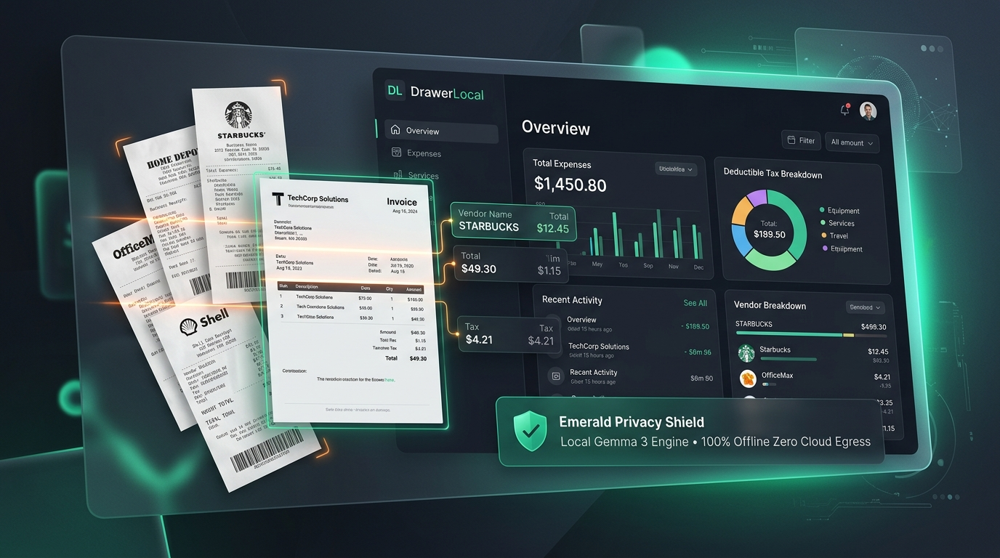
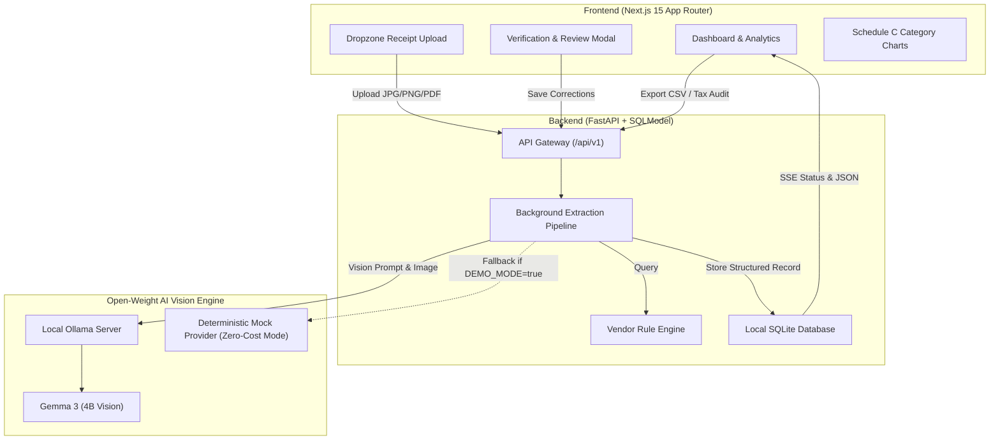

# DrawerLocal 🗄️⚡

> **"Your receipts, sorted. Your data, never uploaded."**

[-black?style=for-the-badge&logo=next.js)](https://nextjs.org/)
[](https://fastapi.tiangolo.com/)
[-4285F4?style=for-the-badge&logo=google)](https://ollama.com/)
[](https://vercel.com/)
[](https://render.com/)
[](LICENSE)

---



---

## 💡 The Problem: The Tax-Time Freelancer Nightmare

Every tax season, millions of freelancers, independent contractors, and boutique agency owners face the same dreaded ritual: digging through shoe boxes, email folders, and camera rolls to compile business receipts and invoice records for Schedule C deductions.

Existing cloud solutions (Expensify, QuickBooks, cloud LLMs) present major friction points:
1. **Confidentiality Risks**: Receipts contain client names, NDA-protected travel destinations, private addresses, and banking details. Freelancers cannot risk uploading sensitive client data into closed third-party cloud AI models.
2. **Subscription Fatigue**: Freelancers pay $20–$50/month for simple document OCR tools with arbitrary document limits.
3. **Hallucination Anxiety**: Pure cloud LLMs often hallucinate digits on crumpled receipts, risking tax audit penalties without an explicit confidence-scoring or verification step.

---

## 🎯 The Solution: DrawerLocal

**DrawerLocal** is an offline-first, open-weight AI receipt & invoice intelligence suite designed as a standalone side-hustle product that privacy-conscious professionals gladly pay for.

- **100% On-Device Vision**: Powered by Google’s open-weight **Gemma 3 (4B)** model served through **Ollama** or deterministic mock for zero-cost demos. No receipt image ever leaves your computer.
- **Auditable Extraction**: Extracts vendor names, transaction dates, tax/VAT, total amounts, and auto-classifies expenses into IRS Schedule C tax categories.
- **Confidence Scoring & Human-in-the-Loop**: Flags low-confidence extractions (< 80%) with a vibrant "Review Needed" badge, allowing instant 1-click modal corrections.
- **Custom Vendor Rules**: Learned local rules (e.g., "Starbucks" ➔ *Meals & Entertainment*, "GitHub" ➔ *Software Operations*) override ambiguous model predictions.
- **Instant Tax Exports**: Download cleaned CSV spreadsheets or structured JSON ready for TurboTax, accountant hand-off, or local audit trails.

---

## 🏗️ System Architecture



---

## 🚀 One-Click Deploy on Vercel (Frontend)

The frontend is built with **Next.js 15 (Turbopack)** and optimized for instantaneous deployment on **Vercel** with zero configuration required.

[](https://vercel.com/new/clone?repository-url=https%3A%2F%2Fgithub.com%2Fvannu07%2FDrawerLocal)

### Step-by-Step Vercel Setup:
1. Go to [vercel.com/new](https://vercel.com/new) and click **Import** next to **`vannu07/DrawerLocal`**.
2. **Crucial Setting**: Next to **Root Directory: `./`**, click **Edit** and choose **`frontend`** (this points Vercel directly to the Next.js app).
3. Leave **Framework Preset** as **Next.js** (automatically detected).
4. (Optional) Set Environment Variables:
   - `NEXT_PUBLIC_API_URL`: Your deployed FastAPI backend URL (e.g. `https://drawerlocal-api.onrender.com/api/v1`). If omitted, the dashboard runs in interactive demo mode with zero errors.
5. Click **Deploy** — builds and goes live in ~30 seconds!

---

## 🐳 Quickstart: Run Locally (Docker Compose)

Spin up the entire stack (FastAPI Backend + Next.js UI + Local AI Engine) with one command:

```bash
# Clone the repository
git clone https://github.com/vannu07/DrawerLocal.git
cd DrawerLocal

# Start all services with Docker Compose
docker compose up --build
```

- **Frontend Dashboard**: [http://localhost:3000](http://localhost:3000)
- **FastAPI Backend & Interactive Swagger Docs**: [http://localhost:8000/docs](http://localhost:8000/docs)
- **Backend Health Check**: [http://localhost:8000/api/v1/health](http://localhost:8000/api/v1/health)

---

## 💻 Manual Local Development

### 1. Backend (FastAPI + Python 3.11+)
```bash
cd backend
python -m venv venv
# On Windows:
.\venv\Scripts\activate
# On Linux/macOS:
source venv/bin/activate

pip install -r requirements.txt
uvicorn app.main:app --reload --port 8000
```

### 2. Frontend (Next.js 15 + Tailwind CSS)
```bash
cd frontend
npm install
npm run dev
```

Open [http://localhost:3000](http://localhost:3000) to view the live dashboard.

---

## 🔬 Open-Weight AI Architecture

DrawerLocal rejects the "thin wrapper over paid closed APIs" trend. Instead, it relies on open weights:

| Component | Technology | Rationale |
| :--- | :--- | :--- |
| **Vision Model** | **Gemma 3 (4B Vision)** | Compact enough to run on modern consumer laptops (M-series Mac, RTX laptop, modern CPU) with high numerical precision on receipt OCR. |
| **Model Runtime** | **Ollama** | Local daemon with zero telemetry, high throughput, and simple REST API compatibility. |
| **Fallback Engine** | **Deterministic Mock** | Enables `DEMO_MODE=true` so judges, reviewers, and users can test the full pipeline without installing Ollama or downloading models. |
| **Persistence** | **SQLite + SQLModel** | Single-file database kept in the user's workspace directory (`backend/data/`). Zero external cloud DB dependency. |

---

## 📊 Business Viability: Who Pays for DrawerLocal?

- **Freelancers & Solopreneurs**: Drowning in 50–200 receipts per month; want a one-time purchase or low-cost self-hosted utility instead of an endless QuickBooks subscription.
- **Digital Nomads & Remote Workers**: Working across borders with multiple currencies and VAT slips who need offline capability when traveling without stable internet.
- **Privacy-Sensitive Contractors (Legal, Healthcare, Tech)**: Under strict NDAs that legally prohibit uploading financial or client receipts to external multi-tenant LLMs.

**Monetization Vectors**:
1. Open-source core engine (Free self-hosted).
2. Packaged desktop binary (Electron / Tauri wrapper for Mac/Windows) sold as a $49 one-time lifetime license.
3. Pre-configured micro-appliance / Docker template for agencies.

---

## 🧪 Testing & Validation

```bash
# Run backend test suite
cd backend
pytest -v

# Run frontend production build test
cd frontend
npm run lint
npm run build
```

---

## 📜 License

Distributed under the **MIT License**. Free for personal and commercial use.

---

*Built with ❤️ for Hacktoberfest 2026: Open-Source AI Challenge (Week 2: Side Hustle).*
